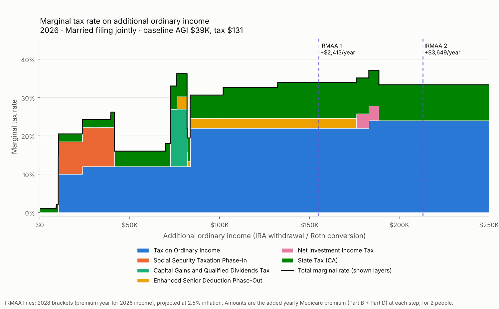
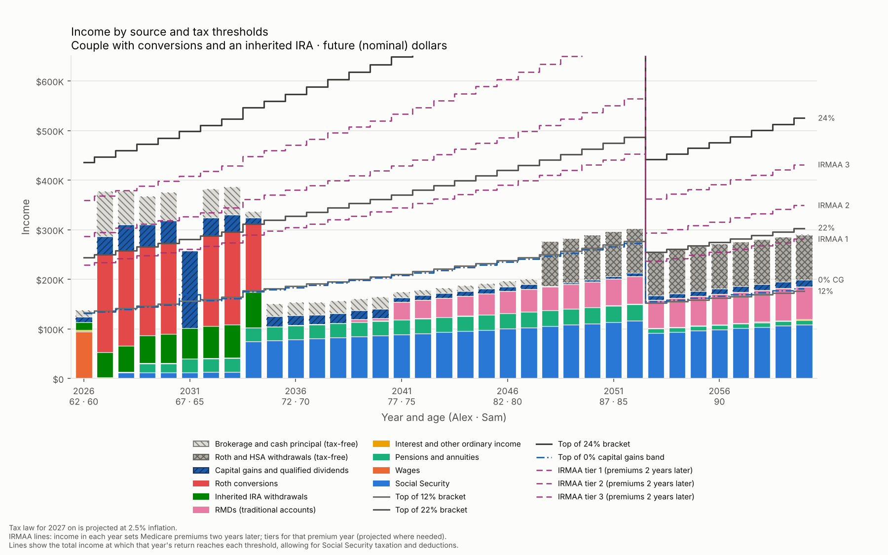

# RetirementTaxPlannerLite

Free, open-source, cross-platform desktop app for **marginal tax graphs**
and **forward-looking tax projections** of the kind retirement planners
show their clients.



The marginal graph shows the real tax rate on each extra dollar of income,
split into layers: ordinary brackets, the Social Security taxation
"tax torpedo", the enhanced senior deduction phase-out, capital gains and
qualified dividends, NIIT and an optional state layer, with IRMAA and ACA
cliff lines on top.

The forward-looking graph shows each year's income by source (Social
Security, pensions, RMDs, inherited IRA withdrawals, Roth conversions,
gains, tax-free withdrawals) against the top of each tax bracket, IRMAA
tiers and the ACA cliff, with account balances on a second tab. A plan
is a profile plus accounts, income streams, Social Security claiming ages
and a short list of rules such as "convert to the top of the 22% bracket
from 63 to 70".



> This is a planning aid, not tax advice. Check the numbers in the tax-law
> files against official sources before relying on them.

## Run it

With [uv](https://docs.astral.sh/uv/) (any OS, including Windows):

```bash
uv sync --extra dev              # creates .venv and installs the app plus pytest
uv run rtpl                      # opens the desktop app
uv run pytest                    # runs the tests
uv run rtpl-chart examples/profiles/retired_couple_ca.json -o chart.png
uv run rtpl-plan examples/plans/couple_conversions_inherited.json -o income.png --balances balances.png
```

With plain pip (`.` means "this folder's pyproject.toml", `-e` makes it
editable, and `[dev]` adds the test tools):

```bash
python -m venv .venv
source .venv/bin/activate        # Windows: .venv\Scripts\activate
pip install -e ".[dev]"
rtpl                             # opens the desktop app
```

Or draw a chart without the window:

```bash
rtpl-chart examples/profiles/retired_couple_ca.json -o chart.png
rtpl-chart examples/profiles/retired_couple_ca.json -o chart.svg --source ltcg --mode dark --table
```

Run the tests with `pytest`.

For a desktop or Start-menu shortcut with the app icon, run
`uv run rtpl-shortcut`. To build a stand-alone app for Windows, macOS or
Linux, see [docs/packaging.md](docs/packaging.md).

## What's in the box

* Profile editor: tax year, filing status, state, one or two people
  (birth year, Medicare Part B enrolled, Social Security, wages, pension,
  IRA withdrawals) and household investment income.
* Graph options: income source (ordinary, qualified dividends, long-term
  gains), X range (default $0–$250K), and a checkbox per layer and
  annotation with suggested defaults from the profile.
* Light, dark or system theme; chart colors editable per layer.
* Fits small screens (down to 1024x768): the inputs and graph options are
  side panels that stay open beside the graph, or with **Auto hide** open
  over it only when needed (Ctrl+1, Ctrl+2). The window remembers its size,
  position and panel layout; View > Reset Window Layout forgets them.
* A data table that lists every rate change and threshold, for screen
  readers and for copying.
* Export to PNG, SVG or PDF.

## Forward-looking plans

In the app, use **File > Open Plan** (try
`examples/plans/couple_conversions_inherited.json`) or **File > New Plan
from Profile**, then the **Forward plan** tab. The left panel's **Plan
items** tab lists the accounts, income, Social Security, strategies (Roth
conversions and withdrawals) and assumptions, each with a bar for the
years it covers. Select one to change it in the form below the list, add
or delete items, or untick one to see the plan without it; the graph and
totals update as you type. **File > Save** saves the plan. From the
command line:

```bash
rtpl-plan plan.json -o income.png --balances balances.png --csv years.csv
rtpl-plan plan.json -o income.svg --detail --todays-dollars --line bracket:0.32
```

See "Forward-looking plan" in [docs/design.md](docs/design.md) for every
field, the yearly steps and the simplifications.

## Tax law files

Federal law for each year is in `src/rtpl/data/federal/<year>.toml`, states
in `src/rtpl/data/states/<code>.toml`. Later years are projected with
inflation using `projection.toml`. To change the law without editing the
package, put your own copy of a file in the `taxlaw/federal` or
`taxlaw/states` folder of your user config directory; it wins over the
shipped one.

Included: federal 2025 and 2026, and 2026 files for all 50 states plus
DC (brackets, deductions and exemptions from the Tax Foundation's 2026
table, plus Social Security and pension/IRA exclusions for retirees, and
Washington's capital gains tax). Each state file lists what it leaves out
under `notes`; hover over the state checkbox in the app to read them.

See [docs/design.md](docs/design.md) for how everything works.
