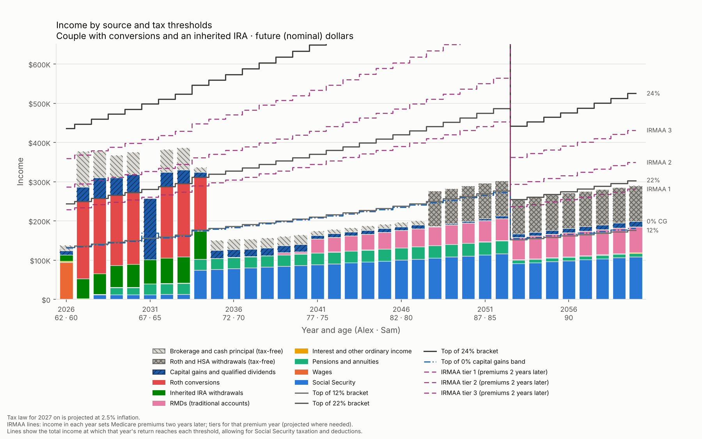

# RetirementTaxPlannerLite design

Status: the marginal tax graph, and a first version of the forward-looking
plan (engine, graphs, command line and an app page that opens plan files;
an in-app editor for accounts and rules comes next).

## Goals

* A free, open-source desktop app (Windows, macOS, Linux) that draws the
  kinds of tax graphs retirement planners show clients: first the
  **marginal tax graph**, then the **forward-looking (year-by-year) graph**.
* Native look, keyboard and screen-reader support, not a browser app.
* Tax law lives in data files people can read and edit, with policy
  switches for things like the senior deduction's expiry.
* Reasonable defaults that hide what cannot matter for a household, while
  letting the user turn any layer back on.

## Stack

| Piece | Choice | Why |
|---|---|---|
| Language | Python 3.11+ | Familiar to the author; `tomllib` in the standard library |
| UI | PySide6 (Qt 6) | Uses UIA / NSAccessibility / AT-SPI, standard menus and shortcuts |
| Charts | matplotlib | Stacked step areas, annotations, PNG/SVG/PDF export |
| Data | TOML (tax law, themes), JSON (profiles) | Hand-editable, comment-friendly |
| Packaging (later) | PyInstaller or Briefcase in GitHub Actions | One download per OS |

## Layout of the code

```
src/rtpl/
  model/profile.py        Profile, Person, Household (JSON)
  taxlaw/loader.py        FederalLaw, StateLaw, TaxLawLibrary (TOML + projection)
  engine/tax.py           compute_tax(): one year, one household
  engine/marginal.py      build_marginal_series(), annotations, default visibility
  model/plan.py           Plan: accounts, income streams, Social Security, rules (JSON)
  engine/forward.py       PlanEngine: the year-by-year loop, threshold lines, year table
  engine/rmd.py           RMD tables (Uniform, Joint and Last Survivor, Single Life)
  engine/social_security.py  own, spousal and survivor benefit rules
  charts/marginal_chart.py  render_marginal() onto any matplotlib Figure
  charts/forward_chart.py   render_income(), render_balances()
  theme.py                light/dark palettes from TOML
  app/                    Qt main window and profile form
  cli.py                  headless marginal chart export (rtpl-chart)
  plan_cli.py             headless plan export: graphs and CSV (rtpl-plan)
  data/federal/*.toml     per-year federal law + projection rules
  data/states/*.toml      per-state law
  data/rmd/tables.toml    IRS life expectancy tables
  data/themes/default.toml
```

The engine never imports Qt, so it is testable on its own and reusable by
the forward-looking plan and the command-line exporter.

## The three setup areas

1. **Baseline (the profile).** Tax year, filing status, state (optional),
   one or two people with birth year, a *Medicare Part B enrolled* choice
   (Automatic / Yes / No, so SSDI recipients under 65 get IRMAA), Social
   Security, wages, pension and IRA withdrawals; household interest,
   dividends, gains, other income, adjustments, itemized deductions, and
   switches for *has a taxable brokerage account* and *buys ACA coverage*.
2. **Tax law (data files).** One TOML file per federal tax year, and one per
   state. See below.
3. **The plan (forward graph).** Accounts, income streams, Social Security
   claiming, life expectancy, assumptions and a short rule list. See
   "Forward-looking plan" below.

## Tax law data

`data/federal/2026.toml` holds brackets, standard deductions, the
additional 65+ deduction, the OBBBA senior deduction (amount, 6% phase-out,
first and last year), capital gains bands, NIIT, Social Security
thresholds, IRMAA tiers for that premium year, and ACA poverty-line
reference points. A `[policy]` table holds switches:

* `personal_exemption` (0 under TCJA, kept by OBBBA)
* `senior_deduction` (on for 2025–2028)
* `aca_enhanced_subsidies` (true for 2025; false for 2026, which brings
  back the 400% FPL cliff)

**State files** (`data/states/XX.toml`, all 50 states plus DC for 2026)
hold brackets, standard deduction, personal exemptions (as deductions or
credits), a Social Security rule (exempt, taxed, exempt from an age, or
exempt below an AGI limit with an optional phase-out), per-person
pension/IRA exclusions with minimum ages, an age-based deduction, capital
gains exclusions or rate caps, and a gains-only tax (Washington). hoh and
mfs use the single values unless a file lists them.

**User overrides.** The app also reads a `taxlaw` folder in the user's
config directory; a file there replaces the shipped file for that year or
state. Nothing needs code changes.

**Projection.** Years without a file are built from the newest enacted
year by `federal/projection.toml`: indexed amounts (brackets, standard
deductions, capital gains bands, IRMAA thresholds and premiums, poverty
line) grow with inflation and round down like the IRS does; statutory
amounts (NIIT and Social Security thresholds, the senior deduction) stay
fixed; `[sunsets]` turns policies off after their last year. Projected law
is labelled as projected on the chart.

## The marginal graph

The X axis is extra income of a chosen kind, $0–$250K by default:

* **Ordinary income** (treated as an IRA withdrawal or Roth conversion, the
  common retiree case: not investment income, but exempt in states that
  exempt retirement income)
* **Qualified dividends**
* **Long-term capital gains**

For each $100 step (finer steps for wider ranges), the engine recomputes the
whole return and splits the change in tax into layers using counterfactual
recomputation, so the layers always sum exactly to the real change:

| Layer (stack order, bottom up) | How it is isolated |
|---|---|
| Tax on Ordinary Income | ordinary tax change with taxable SS and the senior deduction frozen |
| Social Security Taxation Phase-In | extra federal income tax (ordinary and gains) from newly taxable SS, senior deduction frozen |
| Capital Gains and Qualified Dividends Tax | gains tax change with taxable SS and the senior deduction frozen: the 0/15/20% rate on added gains, or gains pushed out of the 0% band by added ordinary income |
| Enhanced Senior Deduction Phase-Out | the remaining federal income tax change, including gains it pushes out of the 0% band |
| Net Investment Income Tax | change in NIIT |
| State Tax (XX) | change in state income tax, labelled with the state code |
| State CG&QD Tax (XX) | change in tax under the state's own capital gains rules: Washington's gains tax, Montana's gains rates, Hawaii's gains rate cap (states that tax gains as regular income show them in State Tax) |

Knock-on effects are charged to their cause. Example: a married couple,
both over 65, adds long-term gains while the senior deduction is phasing
out. Each extra dollar shrinks the deduction by 12 cents, which adds 12
cents of ordinary income (12% bracket) and pushes 12 cents of existing
gains out of the 0% band (15%). The graph shows 15% in the capital gains
layer and 0.12 × (12% + 15%) = 3.24% in the senior deduction layer.

The total line is the sum of the *shown* layers, so turning off the state
layer gives a federal-only picture.

**Annotations** are cliffs in premiums, not taxes, so they are vertical
lines rather than part of the rate:

* **IRMAA.** Income in year *Y* sets Medicare premiums in *Y + 2*. The line
  sits where MAGI (AGI + tax-exempt interest) crosses each tier for the
  premium year, using projected thresholds when that year has no file. The
  label gives the added yearly premium for the people who will be enrolled.
  Projection uses the profile's *Inflation rate* (default 2.5%): the
  thresholds are CPI-indexed and rounded to $1,000, and the top tier
  ($500K / $750K) is frozen in statute until it starts indexing in 2028.
  A *IRMAA brackets* option switches to this year's published brackets
  for comparison with tools that show those.
* **ACA.** Lines at 138% FPL (Medicaid in expansion states), 250% (cost
  sharing reductions) and, when enhanced credits are off, the 400% subsidy
  cliff, using ACA MAGI (AGI + tax-exempt interest + untaxed Social
  Security).

**Default visibility** (every item is a checkbox the user can override;
*Reset to suggested* undoes overrides):

| Item | Shown by default when |
|---|---|
| Ordinary income tax | always |
| SS phase-in, senior phase-out, NIIT | the layer is non-zero somewhere on the graph |
| Capital gains / QD | brokerage account, existing gains or dividends, or a gains/dividends source |
| State | a state with an income tax is entered |
| IRMAA | someone is on Medicare by the premium year (age 63+ now, or Part B enrolled) |
| ACA | the household buys marketplace coverage and someone is under 65 and not on Medicare |

## Accessibility and CUA

* Standard menus with mnemonics and shortcuts (Ctrl+N/O/S, Ctrl+E export).
* Every form field has a label buddy and an accessible name.
* A **Data table** tab lists where the marginal rate changes and what each
  annotation means, so the chart's content is available as text.
* Layers are also told apart by legend order and labels, not color alone.

## Colors and themes

`data/themes/default.toml` defines light and dark palettes. Layer colors
come from a colorblind-checked categorical set, stepped separately for each
background. *View → Chart Colors…* edits any layer color for either mode and
saves to `theme.toml` in the user config folder. The defaults are our own
palette; if you want house colors from a planner's charts, drop their hex
values into the theme file.

## Not modelled yet

Credits (child, saver's, elderly), AMT, QBI, the 0.9% additional Medicare
tax, self-employment tax, local income taxes, most state credits, and the
state rules each state file lists under `notes` (income phase-outs of
state exemptions, cliff-style pension exclusions, special capital gains
rates), ACA premium tax credit dollar
amounts (only the thresholds are drawn), the qualifying surviving spouse
filing status (issue #2).

## Forward-looking plan



A plan is the baseline profile (people, filing status, state, inflation)
plus accounts, income streams, Social Security choices, life expectancy,
assumptions and a short rule list. It is saved as JSON; see
`examples/plans/couple_conversions_inherited.json`. The app's **Forward
plan** page opens plan files, and the profile on the left is the plan's
baseline, so edits there flow into the plan. `rtpl-plan` draws the same
graphs and writes the year table as CSV.

### Design decisions

* **Rules only, balances tracked.** Balances grow and drive RMDs and
  "fill to a target" conversions, but money comes out of an account only
  where an RMD or a rule says so. Spending-driven withdrawals (a spending
  target with a withdrawal order) are a later step that fits this model.
* **Ages** are the age reached by December 31. A timing is stored as one
  person's age (or a calendar year if the user prefers) and can be shown as
  the other person's age or the year.
* **Accounts are individual.** Each spouse can hold several of each type;
  the graph groups them by type, and *Show each source separately* splits
  them out by account, person and income stream.

### What goes in

| Item | Fields |
|---|---|
| Account | id, type (traditional IRA, 401(k)/403(b), inherited IRA, Roth IRA, Roth 401(k), HSA, taxable brokerage, cash), owner, balance, optional return; taxable: cost basis and yields (interest, qualified and non-qualified dividends, capital gain distributions); traditional: spouse is sole beneficiary; inherited: year inherited, original owner's birth year, whether they had started RMDs, eligible designated beneficiary |
| Income stream | wages, pension, foreign pension, annuity, interest, qualified dividends, long-term gain, other ordinary, tax-exempt; owner, yearly amount in the first year paid, start and end (age or year; one year for a one-off), growth (COLA or raises; pensions default to 0%), survivor %, federal taxable % |
| Social Security (per person) | benefit at full retirement age (today's dollars), claiming age (years and months), or the benefit already being paid; SSDI, with an optional early end age (a claiming age past FRA suspends SSDI's retirement benefit until then) |
| Person | death age (optional) |
| Assumptions | inflation, Social Security COLA, default return, cash return, yearly spending (today's dollars), plan end age, MAGI for the two years before the plan (for IRMAA) |
| Rule | Roth conversion or withdrawal, from one account, over a span of years; amount: fixed, fill to a target (top of a bracket, top of the 0% gains band, under an IRMAA tier, an ACA % of the poverty line, or a MAGI), spread the balance evenly over the rule's remaining years (1/N), or the whole balance |

**Overrides.** For each account and kind of rule, the rule with the
narrowest span wins in a year (ties go to the later rule). So "fill to 22%,
ages 63 to 70" plus "2031: convert $0" skips one year without splitting
the range. A withdrawal rule's amount is the year's total from that
account, so an RMD counts toward it; conversions come on top of RMDs.

### The yearly loop

1. Accounts of someone who died the year before pass to the survivor
   (spousal rollover).
2. **RMDs.** Traditional accounts from 73 (born 1951–59) or 75 (born
   1960+), using the Uniform Lifetime table, or the Joint and Last
   Survivor table when the spouse is the sole beneficiary and more than 10
   years younger. Inherited IRAs: yearly RMDs from the Single Life table
   (non-recalculating, from the year after death, using the longer of the
   beneficiary's and the owner's remaining expectancy) when the owner had
   started RMDs or the beneficiary is eligible to stretch, and the whole
   balance in the 10-year deadline year.
3. **Income.** Streams, taxable-account yields (reinvested) and cash
   interest.
4. **Social Security.** Own benefit with early-claiming reductions or
   delayed credits; a spousal top-up (half the other's full benefit, less
   one's own, reduced if started early) once both have filed, which makes
   "claim my own at 62, switch to spousal when my spouse files" happen on
   its own; deemed filing means "spousal first, own later" is not offered.
   After a death, the survivor gets the larger of their own benefit and the
   deceased's (at least 82.5% of the deceased's full benefit if they had
   claimed). SSDI is paid at the full benefit and becomes a retirement
   benefit at full retirement age. With a claiming age past FRA the benefit
   is suspended from FRA and restarts then with delayed credits (so "SSDI
   until FRA, then let it grow to 70" works). An optional SSDI end age
   covers a return to work: nothing is paid until the claiming age, which
   then works as an ordinary claim. While a benefit is suspended, the
   spouse's spousal benefit on that record stops too.
5. **Rules.** Fixed, spread and whole-balance rules first, then fill rules
   in list order; each fill amount is solved by bisection on the whole
   return.
6. **Tax.** `compute_tax()` with that year's law (projected past the newest
   data file), the year's filing status (joint through the year of death,
   then single), and inflation-indexed adjustments and itemized deductions.
7. **Cash flow.** Income minus spending, tax and IRMAA surcharges. A surplus
   goes into the taxable account (or cash); a deficit is taken from cash,
   then the taxable account, realizing gains in proportion to the basis,
   which feeds back into the tax (iterated). Anything still short is
   reported as a shortfall in the graph's notes and the year table.
8. **IRMAA.** Premiums in year *Y* use MAGI from *Y − 2* (the plan's own
   years, or the MAGI entered for the years before the plan) and that
   year's filing status.
9. **Balances** grow by their return.

### The graphs

**Income and brackets.** Bars are income by source, in this stack order:
Social Security, wages, pensions and annuities (including foreign
pensions), interest and other ordinary income, RMDs, inherited IRA
withdrawals, other IRA withdrawals, Roth conversions, capital gains and
qualified dividends, then tax-free money (tax-exempt interest, Roth and
HSA withdrawals, brokerage and cash principal) in light hatched grays that
can be switched off.

Lines, each on or off: the top of each ordinary bracket, the top of the 0%
capital gains band, IRMAA tiers, the ACA 400% line and the deductions line
(where taxable income starts). **Lines are in the same dollars as the
bars**: each is the total income at which that year's return would reach
the threshold, found by adding or removing ordinary income and recomputing
the return. That accounts for Social Security taxation, the standard and
senior deductions and the year's filing status, so where a bar crosses a
line is where the income really reaches it. Bracket tops are read against
the top of the ordinary segments, because gains stack above ordinary
income on the return; the other lines are read against the whole taxable
bar. IRMAA lines use the tiers for the premium year two years later.

Suggested lines: the brackets the bars reach plus the next one up (not
10%), the 0% gains band if there are gains, IRMAA tiers the bars come
near if anyone will be on Medicare, and ACA if the household buys
marketplace coverage.

**Balances.** Year-end balances by account type (or by account), colored
to match the income each feeds. **Year table.** Every year's income by
category, AGI, taxable income, MAGI, federal and state tax, IRMAA, total
balances and notes, for screen readers and copying.

A *today's dollars* switch divides every amount by inflation since the
first year.

### Data sources and checks

* `data/rmd/tables.toml` holds the Uniform Lifetime and Single Life tables
  (IRS Publication 590-B, 2022 and later). The Joint and Last Survivor
  table is derived from the Single Life table's mortality; that
  reproduces every Uniform Lifetime entry (a 10-year age gap) to within
  0.1 year. A user copy can add the published joint table.
* Social Security factors follow SSA's published reduction and credit
  rules (5/9% and 5/12% a month early, 2/3% a month delayed; spousal
  25/36% and 5/12%).

### Simplifications in this version

* No birth month: a benefit claimed at age *A* starts in January of the
  year the person reaches *A* (a claim at *A* years and *M* months pays
  12 − *M* months that year).
* After SSDI ends early, a later early claim takes the full early-claiming
  reduction (the credit for months already on SSDI is not applied).
* No Social Security earnings test; no early-survivor reduction; a survivor
  steps up the year after the death.
* Spousal and survivor benefits assume the couple stays married to each
  other; divorced-spouse benefits are not modelled.
* State taxes treat foreign pensions as other ordinary income (no state
  pension exclusion), and use the same taxable share as the federal return.
* An inherited IRA left by a spouse who dies during the plan is rolled over
  into the survivor's own account. Inherited Roth IRAs are not modelled.
* Withdrawals from Roth accounts and HSAs are treated as qualified (tax-free).
* Returns are a flat rate per account; no Monte Carlo trials yet.

### Next steps

* An in-app editor for accounts, income streams, Social Security and rules.
* A spending tab: a spending target line on the income graph, and
  optionally withdrawals that follow a spending need and an account order.
* A tax-dollars view (tax paid per year by layer).
* Qualifying surviving spouse filing (issue #2).
